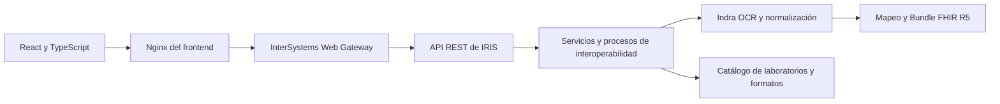

# IRIS Scan2FHIR · Extracción en dos pasos

Flujo: **PDF → OCR y normalización de tablas → recursos y Bundle FHIR R5 JSON**.
React carga el PDF; IRIS ejecuta las etapas mediante interoperabilidad y conserva su traza.
Todo el Python de la aplicación es Embedded Python en clases ObjectScript.
La extracción y la generación FHIR utilizan reglas deterministas.

## Arquitectura general

La aplicación se distribuye en tres contenedores. El navegador muestra la aplicación React;
Nginx sirve sus archivos y reenvía las peticiones de `/api/app/` a Web Gateway. Este último
conecta con la API REST de IRIS en el namespace `APP`.



| Servicio | Función | Acceso local por defecto |
| --- | --- | --- |
| `frontend` | Interfaz React y proxy Nginx hacia la API. | `http://localhost:5174` |
| `webgateway` | Conexión entre las peticiones HTTP y las clases REST de IRIS. | `http://localhost:8083/api/app` |
| `iris` | OCR, reglas de tablas, catálogo, mapeo FHIR, persistencia y trazas. | Portal en `http://localhost:52775`; puerto de servidor `1974`. |

No se utiliza Qwen ni otro LLM. El OCR y la transformación se ejecutan localmente en el backend.

## Backend: IRIS for Health y ObjectScript

El backend utiliza **InterSystems IRIS for Health Community 2026.3 preliminar**, con el código
de aplicación en [iris/src/App](iris/src/App). ObjectScript define la API, los mensajes y la
producción de interoperabilidad. La lectura OCR y los algoritmos de transformación están escritos
en Embedded Python dentro de esas clases; no hay un servicio Python independiente.

La API recibe el PDF binario, comprueba los límites de tamaño y páginas y entrega el trabajo a
`App.Interop.Production`. Los servicios reciben las solicitudes; los Business Processes coordinan
las etapas; las Business Operations realizan el OCR, la identificación, la normalización y el
mapeo. Los mensajes conservan los resultados intermedios y las sesiones permiten seguir su traza.

| Área | Clases principales | Responsabilidad |
| --- | --- | --- |
| API REST | `App.REST.Api` | Publicar los endpoints bajo `/api/app` y devolver resultados, estado y errores. |
| Coordinación del documento | `App.Interop.TablePreviewService`, `App.Interop.TablePreviewProcess` | Ejecutar Descubrimiento o la extracción en dos pasos. |
| OCR | `App.Interop.OCROperation`, `App.Interop.IndraOCR`, `App.Interop.PythonProcessor` | Convertir el PDF con Indra OCR y conservar texto, HTML y posiciones. |
| Reconocimiento | `App.Interop.DocumentIdentifier`, `App.Interop.DocumentDiscovery` | Identificar el laboratorio, reutilizar un formato o descubrir sus tablas. |
| Preparación | `App.Interop.DocumentContent`, `App.Interop.InformationTables`, `App.Interop.TableReconstruction` | Excluir márgenes, derivar tablas informativas y seleccionar la estructura de cada tabla. |
| Normalización | `App.Interop.GridTables`, `App.Interop.LabelValueTables`, `App.Interop.DeterministicTables` | Reconstruir cabeceras, celdas y registros mediante reglas con procedencia OCR. |
| Configuración persistente | `App.Catalog.Repository`, `App.Catalog.Laboratory`, `App.Catalog.DocumentDefinition`, `App.Interop.CatalogValidation` | Guardar laboratorios, formatos versionados, tablas propias y asignaciones validadas. |
| Generación FHIR | `App.Interop.FHIRMappingProcess`, `App.FHIR.RowCompiler`, `App.FHIR.Mapping` | Compilar las asignaciones y construir recursos y referencias del Bundle. |
| Modelo y serialización | `App.FHIR.ModelCatalog`, `App.FHIR.ModelBridge` | Consultar rutas y tipos R5 y comprobar la serialización con las clases ObjectScript del modelo. |
| Seguimiento | `App.Interop.PreviewProgress`, `App.Interop.Diagnostics` | Exponer progreso y tiempos y detallar los errores de cada etapa. |

El flujo de generación consta de dos pasos:

1. **Extracción y normalización:** OCR, reconocimiento del formato, limpieza de márgenes y
   reconstrucción de tablas. Cada valor mantiene sus celdas o fragmentos de texto de origen.
2. **Construcción FHIR:** `RowCompiler` convierte `schema.rowMapping`,
   `schema.informationMapping` y las reglas avanzadas en un plan. `Mapping` aplica ese plan y
   comprueba los recursos con el núcleo R5 y las clases locales antes de devolver el Bundle JSON.

El catálogo guarda las tablas y sus mapeos dentro de las versiones documentales. Las tablas
informativas pueden generar varias instancias del mismo tipo de recurso; las tablas de resultados
pueden generar un recurso por fila. El análisis fija la versión del formato utilizado.
La persistencia activa reside en el volumen Docker `iris-scan2fhir-iris-data` con el nombre de
proyecto por defecto. Los resultados temporales disponibles para repetir el paso FHIR tienen
una vigencia de una hora; las trazas de interoperabilidad se almacenan por separado.

## Frontend: React, TypeScript y Vite

El frontend está en [frontend/src](frontend/src), utiliza **React 19**, **TypeScript** y **Vite 7**.
Gestiona la carga de archivos, la configuración y la revisión de resultados. El backend realiza
el OCR, la reconstrucción de tablas, la validación de las asignaciones y la generación del Bundle.

La interfaz ofrece tres vistas:

- **Descubrimiento:** subir un PDF de ejemplo, elegir o reconocer el laboratorio y revisar las tablas detectadas.
- **Configuración:** administrar laboratorios y sus nombres de reconocimiento, formatos, tablas,
  recursos de destino, campos FHIR y posiciones de las listas.
- **Generación FHIR:** aplicar un formato guardado, seguir el progreso, revisar las incidencias y
  descargar el Bundle. También permite repetir la construcción FHIR sin ejecutar otra vez el OCR.

| Componente o archivo | Función |
| --- | --- |
| `App.tsx` | Navegación, selección del PDF y envío a Descubrimiento o Generación FHIR. |
| `CatalogManager.tsx` | Edición del catálogo, versiones y asignación de formatos a laboratorios. |
| `DocumentTablesEditor.tsx` | Configuración de las tablas y grupos propios de cada formato. |
| `InformationTableEditor.tsx` | Vista previa de etiquetas y valores de las tablas informativas. |
| `InformationFHIRMappingEditor.tsx` | Lista de instancias FHIR y asignación de cada campo informativo a una instancia y una ruta. |
| `RowFHIRMappingEditor.tsx` | Recurso por fila y equivalencias FHIR de las columnas de resultados. |
| `FHIRTargetPicker.tsx`, `FHIRPathPositions.tsx` | Selección de campos del modelo y posiciones de elementos repetidos. |
| `AnalysisProgress.tsx` | Consulta periódica del estado y visualización de los tiempos. |
| `ExtractionResult.tsx`, `TablePreviewPanel.tsx`, `FHIRPreviewPanel.tsx` | Tablas originales y normalizadas, Bundle, incidencias, procedencia y descargas. |
| `api.ts`, `catalog.ts` | Cliente HTTP y contratos TypeScript para el análisis y la configuración. |

Las opciones de recursos, campos y tipos se consultan al backend mediante `/fhir/model`.
El frontend ofrece recomendaciones deterministas editables, pero IRIS valida la configuración al
guardarla. Los valores extraídos de un ejemplo no se guardan automáticamente como parte del formato.

En Docker, [frontend/nginx.conf](frontend/nginx.conf) publica la interfaz y actúa como proxy
hacia `webgateway`. Durante el desarrollo, [frontend/vite.config.ts](frontend/vite.config.ts)
reenvía `/api/app` a `http://localhost:8083`. En ambos casos, el cliente utiliza rutas relativas.
El PDF se envía con `Content-Type: application/pdf`; los endpoints de configuración utilizan JSON.
Mientras se procesa, la interfaz consulta el progreso cada segundo usando el `analysisId`.

Para desarrollar únicamente la interfaz, con IRIS y Web Gateway arrancados:

```powershell
cd frontend
npm ci
npm run dev
```

`npm run build` comprueba TypeScript y genera los archivos de `frontend/dist` para Nginx.
Los cambios de backend se compilan en IRIS; modificar el frontend no requiere recompilar las clases.

## Funcionamiento de la extracción

La conversión PDF utiliza **Indra OCR 1.1.2**, con ONNX Runtime en CPU. Se conservan su texto,
las tablas HTML originales, las celdas combinadas, las posiciones de líneas y bloques y sus
etiquetas de cabecera y pie. Todo se ejecuta en Embedded Python dentro de **Indra OCR Operation**.

`OCR_THREADS` controla los hilos de CPU. Los modelos se mantienen en la caché persistente
`iris/shared/huggingface`; Indra los descarga al utilizarlos por primera vez si no están disponibles.
Los informes se procesan localmente. El tiempo de inicialización está incluido en el OCR de la
primera petición. No se necesita GPU para la extracción. Las licencias se documentan en
[THIRD_PARTY_NOTICES.md](THIRD_PARTY_NOTICES.md).

La limpieza de cabeceras y pies se aplica después del OCR y conserva el resultado original.
Los análisis históricos y las asignaciones FHIR se mantienen al cambiar la imagen.

El descubrimiento identifica tablas informativas de etiquetas y valores. Si Indra devuelve la
cabecera de la primera página como líneas posicionadas, se añade una tabla derivada al final de
esa página, conservando el OCR original y la numeración de las tablas físicas. Se separan las
columnas de información y los campos vacíos no se completan con datos de la fila siguiente.
Cada valor derivado conserva las líneas y posiciones de texto de origen. Los fragmentos que no
se pueden asociar con seguridad se muestran como contenido sin asignar.

En **Configuración → Tablas del documento**, una tabla informativa permite editar sus etiquetas,
recalcular la extracción del ejemplo y ver los valores junto a los campos FHIR. Su alcance por
defecto es la primera página. El usuario define las instancias de recursos y el destino de cada
campo; las reglas avanzadas permiten completar otras transformaciones. La definición guarda etiquetas y
reglas, no los valores del paciente del ejemplo. Para incorporar estas tablas a formatos ya
guardados, volver a pasar el PDF por Descubrimiento; los formatos anteriores se conservan.

Prueba de ambos documentos y de la conversión a Patient: `./scripts/test_information_tables.ps1`.

Las pruebas de normalización verifican la conservación de las celdas detectadas, no la cobertura
completa del documento. Los resultados del reconocimiento visual deben revisarse en Descubrimiento.

El menú separa tres tareas:

- **Descubrimiento**: carga un ejemplo, detecta las tablas y guarda un formato revisable dentro del
  laboratorio. Puede seleccionarse el laboratorio o intentar reconocerlo. Los orígenes desconocidos
  se guardan desactivados, pendientes de identificar. No se generan equivalencias ni recursos FHIR.
- **Configuración**: permite revisar el formato, sus tablas, tipos de valor y destinos FHIR.
- **Generación FHIR**: utiliza una definición existente y ejecuta ambos pasos con una sola acción.
  Si el formato es desconocido, indica que debe pasar primero por Descubrimiento.

El descubrimiento nuevo se limita a **alinear cabeceras y columnas**. Agrupa las celdas físicas que
quedan bajo una misma cabecera, respeta `colspan`/`rowspan`, conserva notas y reutiliza cabeceras
en continuaciones compatibles. No deduce recursos, roles clínicos ni tipos numéricos; no separa
por suposición un valor y un rango mezclados en una celda. Los textos y sus fragmentos OCR se conservan.
Los formatos anteriores conservan sus reglas y asignaciones.

En **Configuración → Formatos pendientes de asignar**, abre el formato y utiliza **Asignar a
laboratorio**. Se traslada su historial completo conservando IDs, versiones, tablas y mapeos FHIR.
Guarda primero cualquier cambio pendiente del formato. La activación para nuevos informes es
explícita y la asignación queda trazada en interoperabilidad. Los laboratorios con el mismo nombre
se distinguen por su código; una coincidencia ambigua no se asigna automáticamente. El emisor
puede reconocerse por su nombre o firmas configuradas aunque todavía no haya un formato activo.
En **Editar laboratorio → Nombres que aparecen en los informes** se configuran las variantes
de su firma impresa. Inicialmente se propone el nombre completo y el nombre distintivo sin
descriptores institucionales iniciales, como `Clínica`. Estas variantes se usan tanto para reconocer
el laboratorio como para reutilizar sus formatos mapeados. Las versiones editadas conservan la
procedencia del descubrimiento y sus vínculos de tablas.
Prueba de asignación y reconocimiento: `./scripts/test_laboratory_links.ps1`.

Cuando existe una columna de unidades vacía, un resultado formado por un número seguido de
un espacio y una unidad textual se separa antes de eliminar columnas vacías: `27.87 mmol/mol`
se convierte en resultado `27.87` y unidad `mmol/mol`. Se admiten decimales con coma, signos y
notación científica. Las unidades ya informadas se respetan; los valores no numéricos y los
rangos mezclados quedan literales. La regla `split-value-unit` conserva los offsets del OCR.

El lector común comprueba las primeras filas y separa los títulos sin alineación de las cabeceras
de campos. Reconoce cabeceras repartidas en varias filas, grupos de resultado/referencia en una
celda y tablas con nombres y valores alternos. Elimina columnas sin contenido en las filas de datos,
pero conserva sus cabeceras como notas. Las filas excluidas mantienen sus celdas y motivos en
`excludedRows`; no desaparecen del OCR. Una tabla de notas no rompe la continuación de la siguiente
tabla de resultados. Los valores dudosos, como `gg`, se conservan sin convertirlos en números.

Si una tabla carece de cabeceras válidas, hereda las de la tabla anterior compatible. Una fila
con nombre y resultado alineados da prioridad a esta continuidad frente a etiquetas con dos
puntos dentro de recomendaciones (por ejemplo, `Mujeres:`). Las cabeceras propias válidas
prevalecen y una cuadrícula incompatible no se fuerza. La herencia aparece en las reglas aplicadas.
Prueba con ambos PDF: `./scripts/test_header_inheritance.ps1`.

En **Configurar este formato** se muestran ejemplos alineados. El usuario elige el recurso y los
campos/tipos FHIR de las columnas relevantes. Sólo se utilizan las columnas con un campo del recurso
asignado. Dejar **Sin asignar · Sólo OCR** conserva la columna en el análisis y la excluye de FHIR;
no hace falta una casilla adicional. Los indicadores de inclusión de versiones anteriores se ignoran.
Las recomendaciones editables completan las asignaciones que falten sin sustituir las existentes.

El resultado de la generación incluye
el Bundle descargable, los tiempos de cada paso, incidencias, recursos excluidos y procedencia.
Las tablas originales y normalizadas se conservan como detalle del primer paso. Se puede repetir
sólo la construcción del Bundle utilizando el análisis guardado, sin volver a ejecutar el OCR.

El segundo paso compila `rowMapping` e `informationMapping` en reglas deterministas. Convierte conceptos y nombres a su
texto FHIR, cantidades con sus unidades, fechas con formato explícito e intervalos con dos límites
numéricos; los rangos de referencia de Observation conservan su texto. Los tipos complejos que
necesitan más estructura se dejan como incidencia para completar sus subcampos. Las reglas avanzadas
guardadas tienen prioridad para las tablas que cubren, evitando recursos duplicados.

Los valores obligatorios adicionales se pueden definir en la tabla. Un código obligatorio no
declarado sólo recibe `unknown` si el conjunto R5 permite ese valor, y queda registrado en el
resultado. No se supone un estado final clínico. Si falta configuración, el primer paso se conserva
y el resultado indica bloqueo o generación parcial; las filas con incidencias no producen recursos
con datos dudosos.

## Reglas de reconstrucción

- Expansión de la geometría HTML mediante colspan y rowspan.
- Cabeceras completas, repartidas, agrupadas y plegadas.
- Separación literal de resultado y unidad unidos en una celda.
- Unión de nombres y valores partidos en filas, cuando no hay conflicto.
- Referencias de varias líneas; exclusión de filas vacías.
- Notas explicativas separadas de las mediciones; conservación de datos etiquetados como th.
- Continuación sin cabecera únicamente con una estructura previa compatible.

Cada fragmento de salida conserva la celda y los límites de caracteres del OCR que lo originaron.
Los contenidos dudosos se conservan y generan incidencias; no se sustituyen letras por números
ni se corrigen unidades, valores o rangos suponiendo su significado clínico.
La validación de cobertura verifica que no desaparezcan caracteres de celdas no vacías.

## Tipos de valor en la plantilla

En **Laboratorios y formatos → documento → Tablas del documento**, cada columna permite indicar:

- **Numérico**: acepta números literales, decimales con punto o coma, notación científica y comparadores.
  Un OCR «gg» genera una incidencia y conserva «gg»; «99» permanece como «99».
- **Texto**: conserva resultados textuales como «Negativo».
- **Mixto / sin definir**: permite compatibilidad con plantillas anteriores y tablas con resultados
  numéricos y cualitativos. Los contenidos no reconocidos requieren revisión.

Las tablas pertenecen al documento del laboratorio. Guardar el documento crea una versión que
incluye una copia de sus tablas, reglas OCR y destinos FHIR. No modifica otros documentos ni sus
versiones anteriores. Las tablas históricas compartidas siguen siendo legibles por compatibilidad;
las nuevas configuraciones se guardan dentro del documento y no crean tablas independientes.

La interfaz compara el OCR original con la tabla reconstruida, destaca incidencias y permite consultar
las reglas aplicadas y descargar la procedencia de cada dato. No registra pacientes ni resultados
clínicos. Puede generar una vista previa de recursos FHIR R5 mediante reglas configuradas.

Los datos administrativos se definen dentro de **Tablas del documento**, con tipo **Etiquetas y
valores**, sin una cabecera de columnas obligatoria. Cada campo conserva el valor literal, las
celdas y los fragmentos OCR que lo justifican. Se reconocen etiquetas y valores en la misma celda,
en celdas contiguas o en la celda inferior de la misma columna. Los conflictos requieren revisión.
La tabla puede limitarse a la primera página. Los campos heredados se presentan como una tabla
del documento sin sobrescribir las versiones históricas; sus asignaciones anteriores siguen siendo
compatibles. El lector de texto anterior sólo se conserva para compatibilidad.

En una tabla informativa, **Recursos que genera esta tabla informativa** define primero las
instancias FHIR con un identificador estable, nombre y tipo. Pueden existir varias del mismo tipo,
por ejemplo dos `Practitioner` para solicitante y validador. En cada campo se elige la instancia de
destino y después su campo FHIR R5. Cada instancia con datos asignados genera un recurso separado
en el Bundle; sus valores adicionales pertenecen exclusivamente a esa instancia. El mapeo
informativo anterior se presenta como una primera instancia conservando sus asignaciones.
Prueba de generación y aislamiento entre instancias: `./scripts/test_information_resources.ps1`.

Las rutas que contienen listas muestran **Elemento de…**, comenzando en 1. Por ejemplo, DNI y
pasaporte pueden usar los elementos 1 y 2 de `identifier`, que corresponden a `identifier[0].value`
y `identifier[1].value`. Dos columnas no pueden escribir el mismo destino de una instancia.
El catálogo hereda los tipos de elementos reutilizados mediante `contentReference`, y los tipos
vacíos se completan cuando el modelo R5 define una única opción. Los errores indican campo,
recurso, ruta y tipo esperado. Prueba: `./scripts/test_mapping_types.ps1`.

Una tabla sin cabecera se comprueba como posible información de etiquetas y valores, salvo
que sus filas de resultados confirmen la continuación de una cuadrícula clínica anterior.
Si hay indicios pero falta una definición verificable, queda como candidata para revisión y conserva
su HTML. La ausencia de cabecera por sí sola no convierte una continuación de resultados en datos
administrativos. Una tabla que mezcla ambas estructuras se deja para revisión.

Los **grupos de tablas** también pertenecen al documento; cada tabla puede pertenecer a un grupo.
Una regla FHIR puede generar un recurso por grupo, tabla completa o registro/fila. Los recursos de
grupo permiten seleccionar la tabla, su repetición, la fila y la columna de cada valor, y enlazar
recursos del mismo grupo. Un grupo incompleto o con tablas inválidas no genera un recurso parcial
sin advertencia. Las equivalencias se configuran manualmente y las propuestas siguen siendo deterministas.

## Arranque

Copiar .env.example a .env y ejecutar:

    docker compose up -d --build

Interfaz: http://localhost:5174  
API: http://localhost:8083/api/app  
Portal IRIS: http://localhost:52775/csp/sys/UtilHome.csp

Los servicios de la aplicación son IRIS, Web Gateway y React; no requieren un servicio LLM ni GPU.
La imagen base es `intersystemsdc/irishealth-community:2026.3-zpm`, versión preliminar 2026.3 de
IRIS for Health de la comunidad de desarrolladores. `IRIS_IMAGE` permite elegir otra versión.
Las trazas antiguas conservan sus campos históricos por compatibilidad con los mensajes guardados.
Los datos activos de IRIS y las trazas se guardan en el volumen Docker
`${COMPOSE_PROJECT_NAME}-iris-data`. No se debe eliminar ese volumen para actualizar el código.
La caché OCR permanece en `iris/shared/huggingface`. Tras migrar desde el almacenamiento de
Windows, `iris/shared/durable` conserva la copia anterior; la instancia activa utiliza el volumen
Linux de Docker, que permite ejecutar correctamente el actualizador de la imagen comunitaria.

## API y seguimiento

- GET /health: estado y límites.
- POST /table-preview?filename=informe.pdf&definitionId=1: PDF binario, Content-Type application/pdf.
  definitionId puede omitirse si se reconoce una definición única. analysisId permite enviar un UUID
  para consultar el progreso durante la petición.
- GET /table-preview/status/{analysisId}: etapa, página, tabla y tiempos. Metadatos disponibles una hora.
- GET /catalog: catálogo versionado.
- POST /discovery: PDF binario; OCR, reconocimiento y descubrimiento de tablas. Acepta analysisId,
  filename y laboratory opcional (código de un laboratorio activo). Reutiliza una definición reconocida
  si cubre todas las tablas; en caso contrario crea un formato con tablas propias, sin modificar los
  anteriores. Las tablas sin estructura verificable conservan su cuadrícula y quedan sin clasificar.
  El resultado permite abrir directamente el formato en Configuración. No construye un Bundle.
- POST /extraction: PDF binario; ejecuta extracción y normalización y después construcción del Bundle.
  Acepta analysisId, filename y definitionId como parámetros, igual que /table-preview.
- POST /catalog/laboratories, /catalog/documents, /catalog/table-types: guardar configuración.
- POST /catalog/assign-laboratory: asignar un formato y su historial a otro laboratorio conservando sus mapeos.
- POST /catalog/preview-information: extraer los valores de una tabla informativa HTML con su configuración.
- POST /catalog/identify: probar reconocimiento de texto y HTML.
- POST /catalog/map-table: extraer una tabla HTML mediante reglas y una definición existente.
- GET /fhir/model?resourceType=Observation: recursos y rutas disponibles según el modelo y núcleo R5.
  Sin recurso devuelve también los tipos de datos; view=children y path permiten navegar por los
  campos inmediatos, con cardinalidades, alternativas de tipo y valores permitidos.
- POST /fhir/preview: transformar un análisis guardado por el servidor, usando su analysisId y una
  configuración de mapeo opcional de borrador. El análisis está disponible durante una hora.

El estado se consulta cada segundo. Los tiempos definitivos de OCR, extracción y proceso completo
se miden con reloj monotónico y se incluyen en el JSON descargable.

## Comprobaciones

    ./scripts/test_tables.ps1
    ./scripts/test_catalog.ps1
    ./scripts/test_table_preview.ps1
    ./scripts/test_fhir.ps1
    ./scripts/test_fhir_api.ps1
    ./scripts/test_table_scopes.ps1
    ./scripts/test_discovery.ps1
    ./scripts/test_discovery_api.ps1
    ./scripts/test_grid_tables.ps1
    ./scripts/test_indra.ps1
    ./scripts/test_information_tables.ps1
    ./scripts/test_information_resources.ps1
    ./scripts/test_mapping_types.ps1
    ./scripts/test_laboratory_links.ps1
    ./scripts/test_header_inheritance.ps1

El corpus test/ocr-tables.json contiene únicamente las 19 tablas OCR de referencia, sin cabeceras
de paciente. Las pruebas cubren estructura, procedencia, números frente a texto, conflictos y
preservación del catálogo. La prueba de catálogo elimina únicamente sus registros sintéticos únicos.
Las pruebas de descubrimiento verifican formatos nuevos, metadatos, cuadrículas sin clasificar,
reutilización de estructuras, tablas adicionales y separación respecto a la generación FHIR.

## Mapeo semi-automático a FHIR R5

Para las tablas de resultados, la vista principal es **Qué representan las filas y las columnas**:

1. Elegir el recurso que representa cada fila: Observation, Patient, Specimen u otro recurso disponible.
2. Indicar, junto a cada columna del formato, su campo de destino y el tipo FHIR correspondiente.
3. Guardar el documento para versionar esta interpretación. Las tablas reconstruidas muestran
   después el recurso por fila y el significado de las columnas sobre los datos extraídos.

Esta declaración se almacena en `schema.rowMapping` y se utiliza en el segundo paso para construir el Bundle;
no sobrescribe las reglas de generación avanzadas ya guardadas. Los campos y tipos
se consultan en el modelo R5 y se valida su compatibilidad al guardar. Se pueden mantener columnas
pendientes de definir. Las propuestas para Observation son deterministas, editables y opcionales.
El recurso nunca se deduce ni se fija por defecto.

En las tablas informativas se utiliza `schema.informationMapping`: `resources` declara las
instancias y `columns` vincula cada campo con una instancia mediante `resourceId` y con su ruta FHIR.
Sus recursos se generan a partir del registro informativo completo, aunque compartan el mismo tipo.

Por ejemplo, una columna de prueba puede representar `Observation.code` (CodeableConcept),
el resultado `valueQuantity` (Quantity) y las unidades `valueQuantity.unit` (string). El intervalo de
referencia se representa por `referenceRange[0]`, cuyo tipo en Observation es BackboneElement;
el tipo Range está disponible en los campos R5 que lo admiten, como `valueRange`.
Los grupos, la extracción OCR y el mapeo anterior permanecen en opciones avanzadas.

En **documento → Tablas del documento → Recurso y tipo de datos de la tabla** se
puede declarar el recurso FHIR de destino y, opcionalmente, su tipo de dato y campo concreto
(por ejemplo Observation → valueQuantity → Quantity). Se comprueba su compatibilidad con R5.
La declaración se guarda junto con el documento, sin gestionar versiones de tabla independientes.
En el editor FHIR del documento se pueden crear reglas desde sus tablas y añadir la asignación al campo declarado;
las equivalencias existentes no se reemplazan. Las reglas deben respetar el recurso declarado
en la tabla de esa versión documental. Estos metadatos no modifican las reglas de extracción OCR.

Tras analizar un PDF, abrir **Transformar a FHIR R5 → Configurar recursos y asignaciones**.
También se puede configurar en la definición documental dentro del catálogo.

1. Añadir una regla y elegir el recurso: Patient, Observation, DiagnosticReport u otro del modelo R5.
2. Seleccionar los campos de cabecera, un tipo de tabla versionado o una tabla concreta.
3. Elegir la repetición: por documento, tabla o fila. Opcionalmente filtrar filas por texto exacto.
4. Asignar cada destino FHIR a un campo de cabecera, columna, fila/celda OCR, constante o referencia
   a recursos generados por otra regla. El selector permite navegar por campos y subcampos del
   recurso, filtrar por tipo de datos y elegir una alternativa concreta cuando FHIR ofrece varias.
   Muestra los tipos, la cardinalidad y las posiciones de las colecciones (por ejemplo name[0].text).
5. Opcionalmente generar una propuesta determinista para Observation basada en los roles de las
   columnas, en una regla sin asignaciones. No sobrescribe las equivalencias existentes. Es un borrador;
   el usuario debe revisar estado, códigos, unidades, referencias y fechas antes de utilizarlo.
6. Generar una vista previa y revisar los recursos excluidos y la procedencia OCR. Descargar el
   Bundle de tipo collection o guardar la configuración en una nueva versión documental.

Al activar el mapeo automático, los siguientes análisis con esa versión generan la vista previa
después de la extracción. No se envía nada a un servidor FHIR ni se realizan altas clínicas.
Los formatos y mapeos históricos no se sobrescriben.

Las reglas conservan la precisión numérica o bloquean la conversión, requieren formato explícito
para fechas y no suponen zonas horarias. Los rangos pueden conservarse como referenceRange.text.
No se asignan códigos LOINC ni UCUM automáticamente; la unidad OCR puede conservarse en Quantity.unit.
Las alternativas FHIR, cardinalidades, rutas y códigos básicos disponibles se comprueban con el
paquete local hl7.fhir.r5.core 5.0.0. Cada recurso y el Bundle se serializan mediante las clases
Spain.FHIR.DTL.vR5.Model proporcionadas; se bloquean descartes o cambios de datos en la serialización.
Esta comprobación no sustituye la validación completa de terminologías, invariantes o perfiles de
una guía de implementación. El resultado es una vista previa para revisión antes de la integración.

Los modelos y el paquete oficial local se copian a iris/vendor/fhir-r5. Para actualizarlos:

    ./scripts/sync-fhir-models.ps1 -Source C:/Code/fhir-r5

Consultar iris/vendor/fhir-r5/ADAPTATIONS.md para los ajustes de compatibilidad XML. El proyecto
original no se modifica. Todo el motor Python de mapeo sigue siendo Embedded Python en interoperabilidad.

## Limpieza de datos de pruebas

Para vaciar los datos de pruebas del namespace `APP`, ejecutar `./scripts/reset-database.ps1`.
Elimina también el catálogo, sus asignaciones FHIR y las trazas de interoperabilidad; conserva
las clases, la configuración, los modelos OCR y los archivos del disco. Detiene la producción
durante la limpieza y la vuelve a iniciar. `./scripts/reset-database.ps1 -WhatIf` muestra el
alcance sin eliminar datos. IRIS debe estar arrancado.
